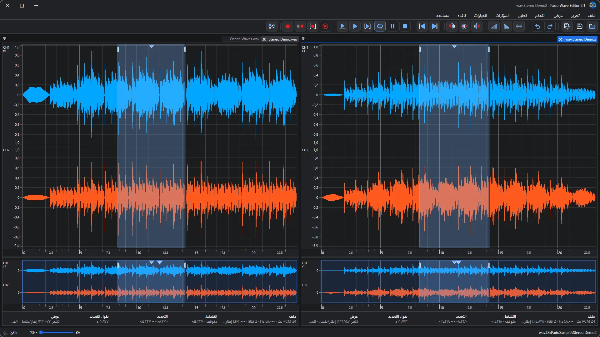
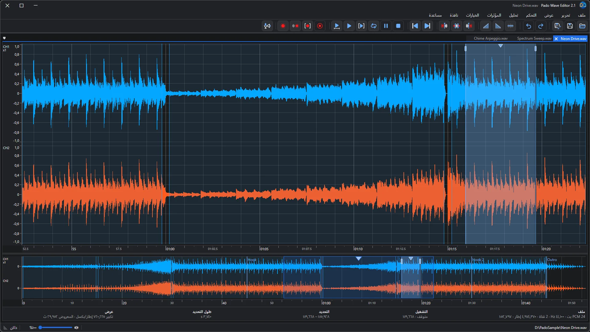
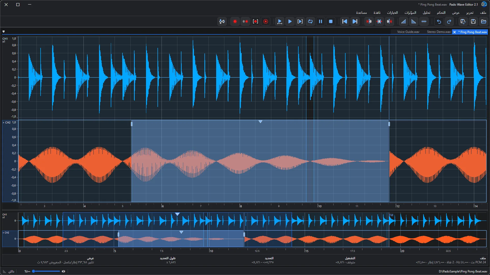
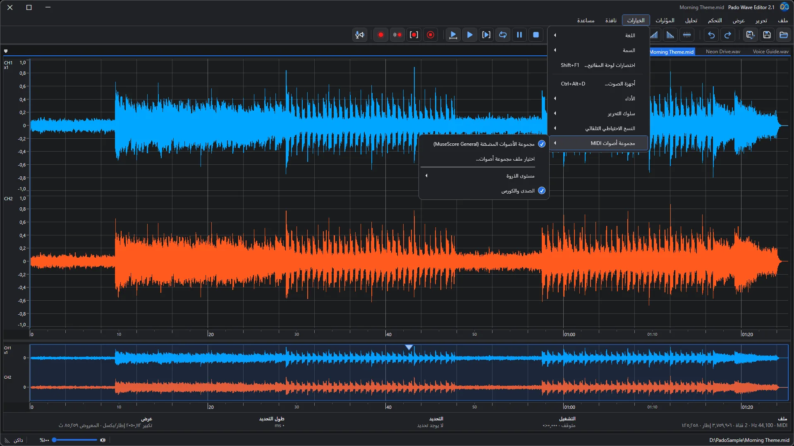
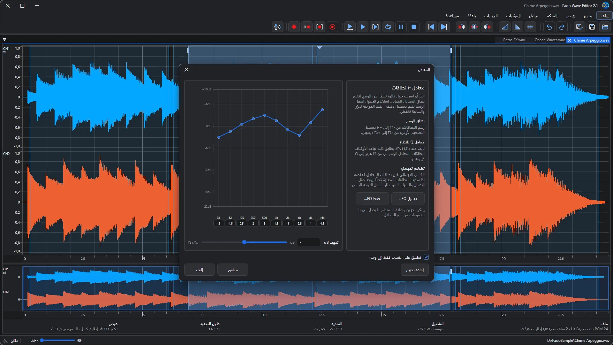
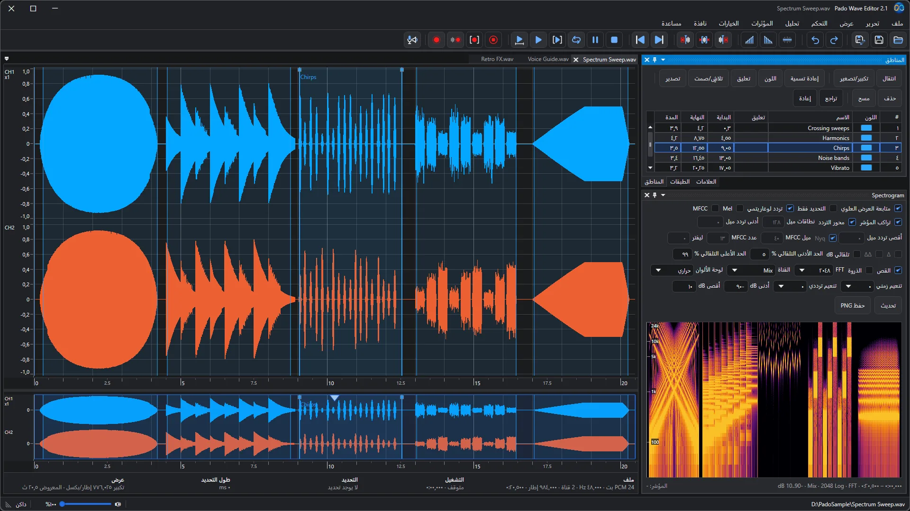
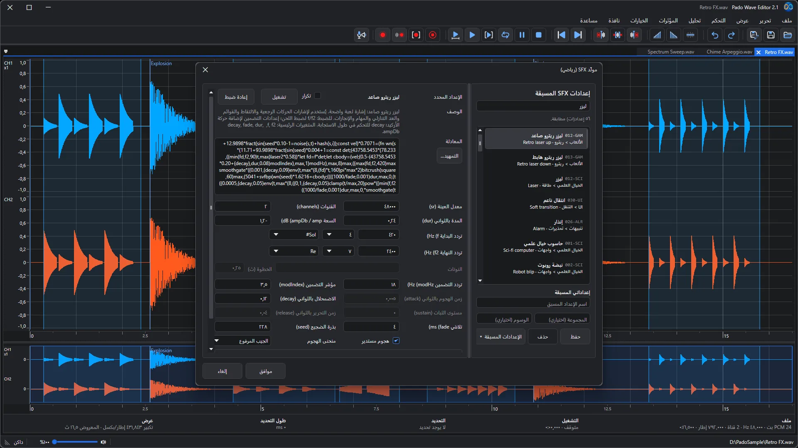
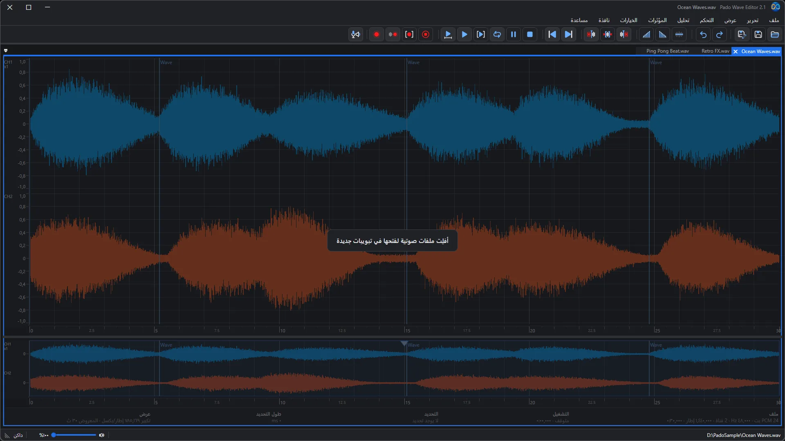
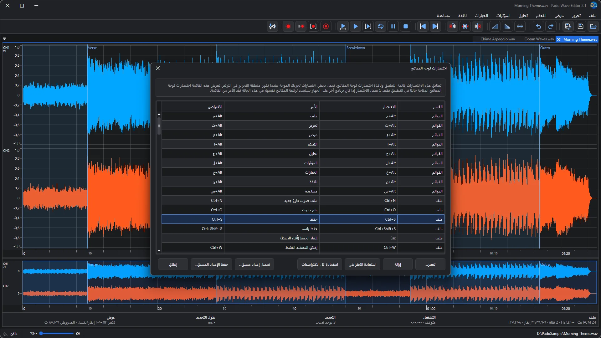
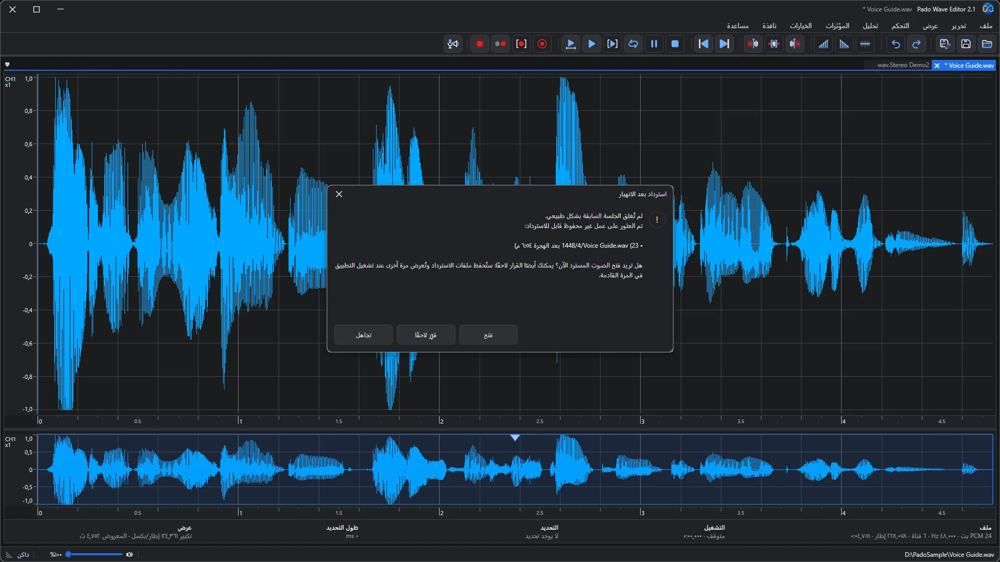

🌐 **Languages**

🇺🇸 [English](README.md) |
🇰🇷 [한국어](README_ko.md) |
🇯🇵 [日本語](README_ja.md) |
🇨🇳 [简体中文](README_zh-Hans.md) |
🇹🇼 [繁體中文](README_zh-Hant.md) |
🇩🇪 [Deutsch](README_de.md) |
🇫🇷 [Français](README_fr.md) |
🇪🇸 [Español](README_es.md) |
🇷🇺 [Русский](README_ru.md) |
🇧🇷 [Português (Brasil)](README_pt-BR.md) |
🇵🇹 [Português (Portugal)](README_pt-PT.md) |
🇸🇦 [العربية](README_ar.md) |
🇮🇳 [हिन्दी](README_hi.md) |
🇮🇩 [Bahasa Indonesia](README_id.md)

    

# Pado Wave Editor 2.1

### محرّر صوت مجاني ترى فيه صوتك — ثم تقصّه وتلصقه وتصقله

تسجيلات الصوت، وتمارين الغناء، والمؤثرات الصوتية لمقاطع الفيديو — اسحب الملف إلى النافذة فيظهر شكل الموجة فورًا. حدّد جزءًا، قصّه، أضف تلاشيًا، ثم احفظ. انتهى الأمر. المسار بسيط حتى لا يضيع أحد، حتى في المرة الأولى.

**مجاني** · **Windows 10 · 11** · **WAV · MP3 · FLAC · OGG · MIDI** · **14 لغة** · **مظهر فاتح وداكن**

[احصل عليه من Microsoft Store](https://apps.microsoft.com/detail/9nj5928hw9pw) · [الدليل الكامل والأسئلة الشائعة](https://easyflow.co.kr/F/Doc/PadoWaveEditor/ar) · [الإصدار السابق (2.0)](v2.0/README_ar.md) · [الإصدار السابق (1.0)](v1.0/README_ar.md)

<i>ثبّت ملفين جنبًا إلى جنب وشغّلهما أو كرّر تشغيلهما أثناء المقارنة</i>

---

## مثالي من أجل

- 🎙️ **تنظيف تسجيلات الصوت** — احذف الأخطاء والتوقفات الطويلة من البودكاست والعروض والمذكرات الصوتية، ووحّد مستوى الصوت.
- 🎧 **المقارنة بين تسجيلين** — ضع ملفين جنبًا إلى جنب، وكرّر المقطع نفسه في كل منهما، واحتفظ بالأفضل.
- 🎹 **تحويل MIDI إلى صوت** — افتح أغنية MIDI فتُعزف مباشرة وتظهر كشكل موجة. اصقلها واحفظها بصيغة WAV أو MP3.
- 🎮 **مؤثرات للألعاب والفيديو** — اختر أصوات الليزر أو الانفجارات أو الإشعارات من الإعدادات المسبقة واصنع أصواتك بنقرات قليلة.
- 🎼 **من العزف إلى النوتة** — اعثر على النغمات في أداء مسجّل واعرضها كنوتة موسيقية. انقر نغمة، وصحّح موضعها أو درجتها أو طولها بمفاتيح الأسهم (أو احذفها بمفتاح Delete)، ثم احفظها كملف MIDI.
- 🔍 **النظر داخل الصوت** — اكتشف الضوضاء والطقطقات بعينك باستخدام المخطط الطيفي وتحليل التردد.

## ثلاث خطوات فقط

1. **افتح** — اسحب الملف إلى النافذة أو اضغط Ctrl+O. تُفتح ملفات WAV وMP3 وFLAC وOGG وMIDI كلها.
2. **حدّد وحرّر** — اسحب على شكل الموجة للتحديد، ثم قصّ أو أضف تلاشيًا أو مؤثرات. أخطأت؟ Ctrl+Z.
3. **احفظ** — اضغط Ctrl+S أو صدّر إلى الصيغة التي تحتاجها.

---

## جولة في الميزات

### 01. حرّر الصوت في مساحة عمل واضحة تعرض الموجات متعددة القنوات

حرّر في شكل الموجة الكبير في الأعلى، واستخدم شريط النظرة العامة في الأسفل لتعرف موقعك في الملف كله. تبقى معلومات الملف وموضع التشغيل وطول التحديد ظاهرة دائمًا في شريط المعلومات أسفل شكل الموجة مباشرة. تعرض الملفات الطويلة شكل موجة سريعًا أولًا ثم تُكمل التفاصيل، فلا تنتظر طويلًا.

### 02. حدّد جميع القنوات وحرّرها معًا أو حرّر قناة واحدة في كل مرة

في الصوت الستيريو يمكنك تحديد القناتين اليسرى (الأعلى) واليمنى (الأسفل) معًا أو واحدة فقط. أزل ضوضاء موجودة في جهة واحدة أو طبّق التلاشي على قناة واحدة — التعديلات الدقيقة تصبح سهلة.

### 03. افتح ملفات MIDI كموجة صوتية تعزفها مجموعة الأصوات المضمّنة وحرّرها

يحتوي ملف MIDI (.mid و.midi و.rmi) على نغمات لا على صوت. يعزفه Pado Wave Editor بخط الصوت المدمج (MuseScore General) ويعرض النتيجة كشكل موجة، فتقصّه وتضيف المؤثرات وتحفظه بصيغة WAV أو MP3 مثل أي صوت. تفضّل خط صوت SF2 أو SF3 آخر؟ غيّره من الخيارات.

### 04. اضبط الصوت وافحصه باستخدام المؤثرات والمرشحات وأدوات التحليل

طبّق المعادل والمرشحات والضاغط والتطبيع وغيرها على الجزء المحدد فقط. اسحب النقاط على الرسم لتشكيل الصوت، واحفظ حتى 10 إعدادات للمعادل لتحمّلها لاحقًا.

### 05. تنقّل بسرعة باستخدام المناطق والعلامات والطبقات ولوحة المخطط الطيفي

المناطق ذات الأسماء والألوان، والعلامات التي تحدد المواضع، والطبقات التي تشغّل المعالجة وتوقفها للمقارنة تُبقيك على المسار حتى في الملفات الطويلة. يعرض المخطط الطيفي الصوت بألوان حسب التردد، فتلمح الضوضاء والطقطقات بعينك.

### 06. أنشئ مؤثرات صوتية من مئات الإعدادات المسبقة المعتمدة على الصيغ

ابحث بين مئات الإعدادات المسبقة — ليزر وانفجارات وتنبيهات وحتى آلات موسيقية — ثم عدّل التردد والمدة والتلاشي واستمع إلى النتيجة فورًا. احفظ ما يعجبك كإعدادات مسبقة خاصة بك. رائع لصنع أصواتك الخاصة للألعاب والفيديو.

### 07. اسحب ملفات الصوت وأفلتها في المحرر لفتحها في علامات تبويب جديدة

اسحب ملفات الصوت من مستكشف الملفات إلى النافذة فقط، وسيُفتح كل ملف في علامة تبويب جديدة. يمكنك إسقاط عدة ملفات دفعة واحدة.

### 08. اعرض اختصارات لوحة المفاتيح وخصّصها

اطّلع على القوائم والاختصارات في جدول واحد، وغيّر أي مفتاح أو استعد الافتراضي. احفظ إعدادك كإعداد مسبق وحمّله متى شئت.

### 09. استعد العمل غير المحفوظ تلقائيًا بعد الإغلاق غير المتوقع

إذا أُغلق التطبيق فجأة، فلا تقلق. عند تشغيله في المرة التالية يعثر على عملك غير المحفوظ ويسألك: فتحه أم التقرير لاحقًا أم تجاهله. اختر لاحقًا وستبقى ملفات الاسترداد محفوظة وتُعرض مجددًا عند التشغيل التالي.

---

## الجديد في الإصدار 2.1

- مربعا الحوار فتح وحفظ: مربع بحث جديد، وخيار الملفات أولاً، وترتيب أسماء الملفات بحسب الأرقام.
- اختر كيف يتابع العرض التشغيل: إبقاء رأس التشغيل في الوسط أو الانتقال إلى الصفحة التالية عند الحافة اليمنى.
- عند التشغيل مجدداً بعد نهاية الملف، يبدأ التشغيل من البداية.
- يمكن ضبط الضاغط ليضغط بسلاسة أكبر ولا يفوّت الأصوات العالية المفاجئة.
- تعرض المؤثرات المطبقة على التحديدات الطويلة تقدّمها ويمكن إلغاؤها.
- عرض أسرع للموجة الصوتية ونافذة النوتة الموسيقية والنسخ واللصق.
- تتبع الأرقام والتواريخ التنسيق الإقليمي في Windows، وتظهر رسائل الخطأ والحالة بجميع اللغات الأربع عشرة.
- إصلاحات في المعادل ومعاينة مولّد المؤثرات الصوتية وتخطيط الواجهة العربية وغيرها، مع أيقونات أوضح للتطبيق.

جاء الإصدار 2.0 بفتح ملفات MIDI كموجة صوتية، والسحب والإفلات، ودعم Ogg Vorbis وFLAC في كل إصدارات Windows، واختصارات لوحة مفاتيح قابلة للتخصيص، والاستعادة التلقائية للملفات، وتسريع الملفات والتسجيلات الطويلة، ومظهر متجدد. [الإصدار السابق (2.0)](v2.0/README_ar.md)

## كل الميزات في لمحة

- افتح ملفات الصوت المدعومة وحرر كل القنوات معًا أو قناة واحدة فقط.
- فتح ملفات MIDI (.mid و.midi و.rmi) كموجة قابلة للتحرير تعزفها مجموعة الأصوات المضمّنة.
- حلّل النوتات في التسجيل واعرضها كنوتة موسيقية وصحّحها ثم احفظها كملف MIDI.
- قص وانسخ والصق واحذف واكتم وطبّق التلاشي مع التراجع والإعادة على التحديد.
- شغّل وكرّر وسجّل واحفظ وصدّر من مساحة عمل واحدة.
- استخدم المناطق والعلامات والطبقات والطيف الترددي للتنقل والتحليل المرئي.
- طبّق إزالة انحياز DC والمرشحات والمعادل وBass Shelf والضغط ومستوى الصوت والتطبيع وHard Clip.
- غيّر سرعة التشغيل وأعد أخذ العينات وأنشئ أصواتًا باستخدام مولّد SFX.
- قلّل النقرات بالتلاشي المتقاطع التلقائي والالتقاط والتلاشي القصير.
- حافظ على استجابة الملفات الطويلة بتحسين الحواسيب الضعيفة وتنقية شكل الموجة تدريجيًا.

تمت ترجمة الواجهة والمساعدة داخل التطبيق. تبقى بعض أسماء المؤثرات القياسية وتنسيقات الملفات والمصطلحات التقنية باللغة الإنجليزية.

## المتطلبات

الصيغ المدعومة: WAV وAIFF وFLAC وOgg Vorbis وMP3 وWMA. تستخدم صيغتا MP3 وWMA مكوّنات الوسائط في Windows المضمّنة في معظم إصدارات Windows؛ وفي إصدارات Windows N، ثبّت حزمة Media Feature Pack المجانية من الإعدادات > التطبيقات > الميزات الاختيارية لتفعيلها. أما WAV وAIFF وFLAC وOgg Vorbis فتعمل دائمًا. يستخدم عارض التعليمات داخل التطبيق Microsoft Edge WebView2 Runtime، وهو مضمّن في Windows 11 ومثبّت مسبقًا على معظم أجهزة Windows 10؛ وفي حال عدم توفّره يتأثر عارض التعليمات فقط، بينما يستمر تحرير الصوت في العمل.

---

## التنزيل

- [احصل عليه من Microsoft Store](https://apps.microsoft.com/detail/9nj5928hw9pw)
- تؤدي صفحة [**Releases**](https://github.com/easyflowinc/PadoWaveEditor/releases) أيضًا إلى Microsoft Store.
- [الدليل الكامل والأسئلة الشائعة](https://easyflow.co.kr/F/Doc/PadoWaveEditor/ar)
- [الإصدار السابق (2.0)](v2.0/README_ar.md)
- [الإصدار السابق (1.0)](v1.0/README_ar.md)

© 2026 Easyflow Inc.

