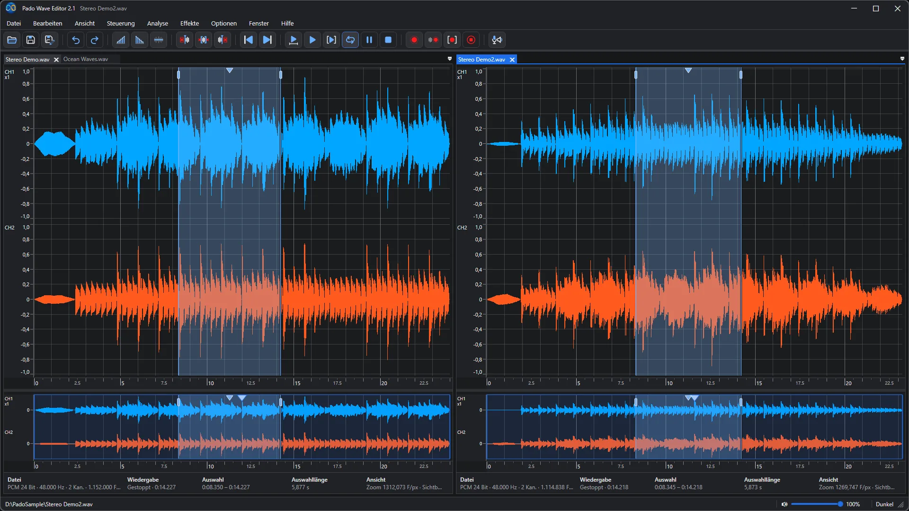
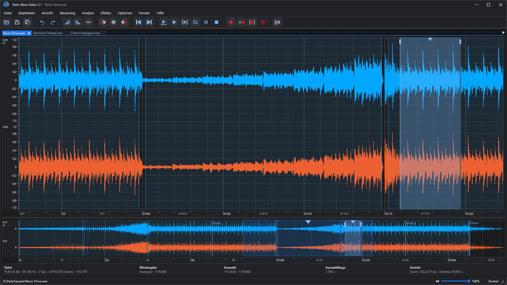
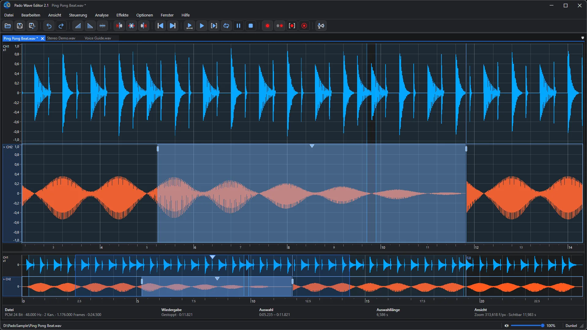
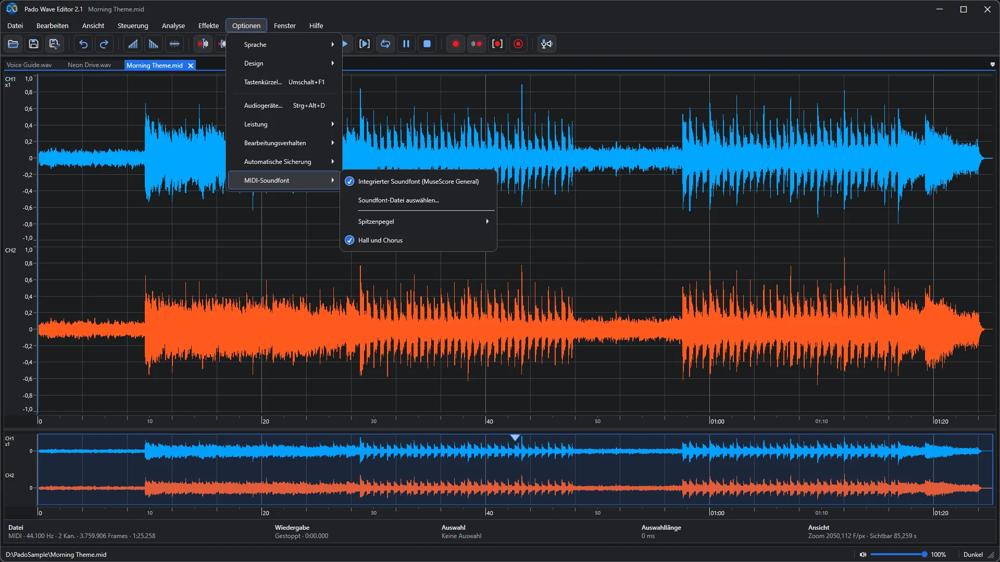
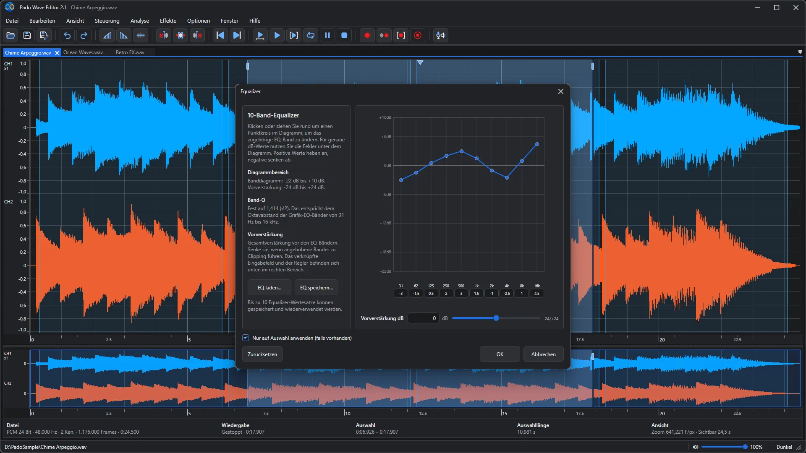
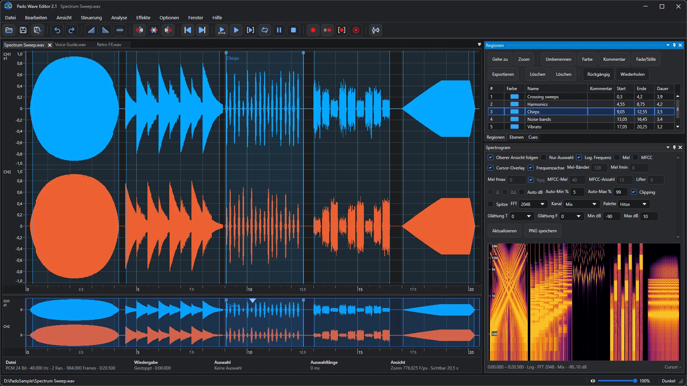
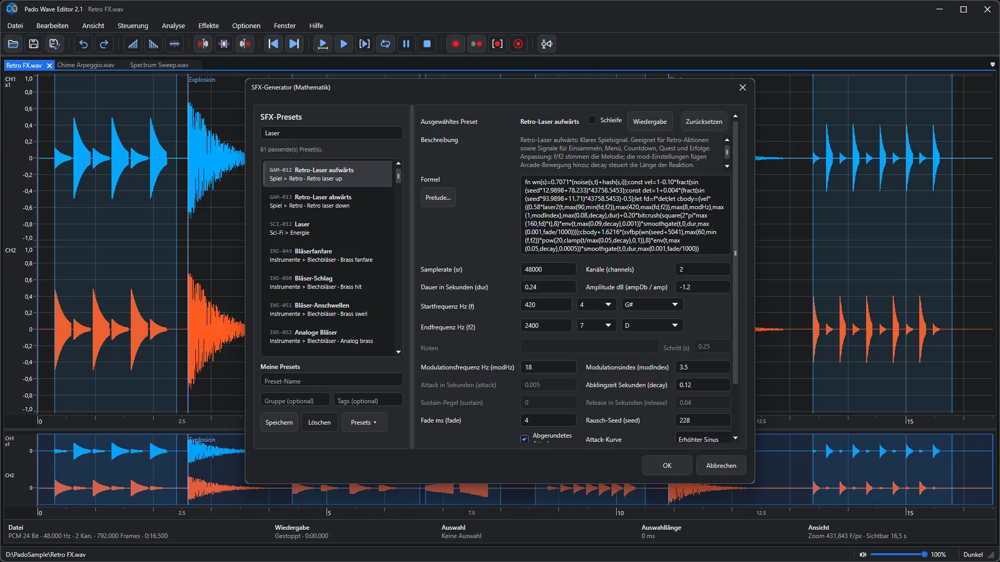
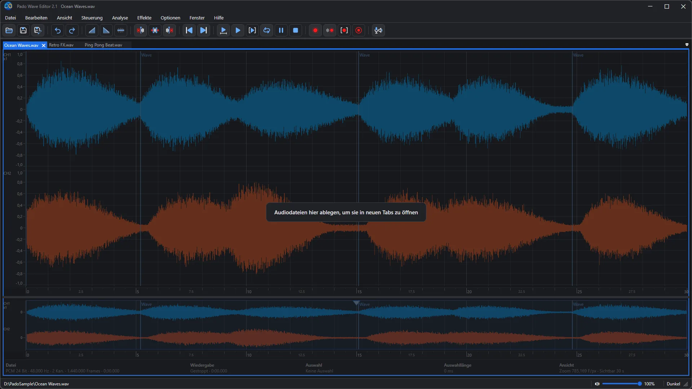
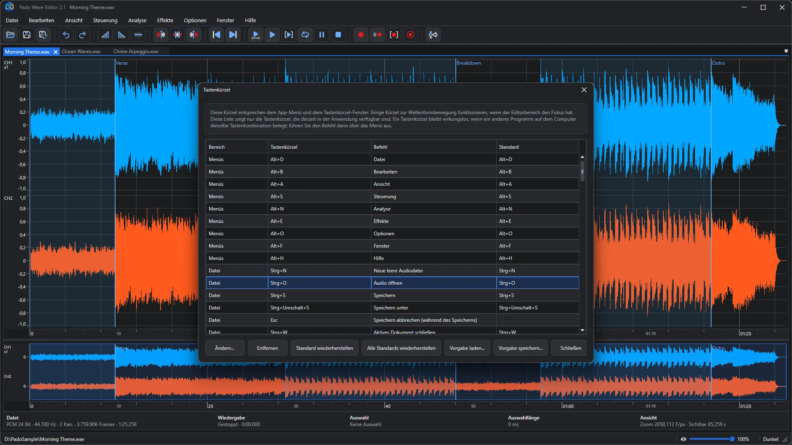
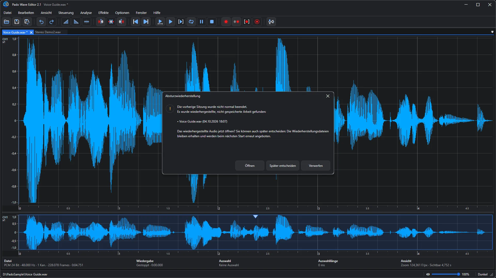

🌐 **Languages**

🇺🇸 [English](README.md) |
🇰🇷 [한국어](README_ko.md) |
🇯🇵 [日本語](README_ja.md) |
🇨🇳 [简体中文](README_zh-Hans.md) |
🇹🇼 [繁體中文](README_zh-Hant.md) |
🇩🇪 [Deutsch](README_de.md) |
🇫🇷 [Français](README_fr.md) |
🇪🇸 [Español](README_es.md) |
🇷🇺 [Русский](README_ru.md) |
🇧🇷 [Português (Brasil)](README_pt-BR.md) |
🇵🇹 [Português (Portugal)](README_pt-PT.md) |
🇸🇦 [العربية](README_ar.md) |
🇮🇳 [हिन्दी](README_hi.md) |
🇮🇩 [Bahasa Indonesia](README_id.md)

    

# Pado Wave Editor 2.1

### Ein kostenloser Audio-Editor, mit dem du deinen Sound siehst – und ihn schneidest, einfügst und feinschleifst

Sprachaufnahmen, Gesangsübungen, Soundeffekte für deine Videos – zieh eine Datei ins Fenster und die Wellenform ist sofort da. Bereich markieren, schneiden, Fade drauf, speichern. Fertig. Der Ablauf bleibt bewusst einfach, damit sich auch Einsteiger nie verlaufen.

**Kostenlos** · **Windows 10 · 11** · **WAV · MP3 · FLAC · OGG · MIDI** · **14 Sprachen** · **Helles & dunkles Design**

[Im Microsoft Store holen](https://apps.microsoft.com/detail/9nj5928hw9pw) · [Ausführliche Anleitung und FAQ](https://easyflow.co.kr/F/Doc/PadoWaveEditor/de) · [Vorversion (2.0)](v2.0/README_de.md) · [Vorversion (1.0)](v1.0/README_de.md)

<i>Zwei Dateien nebeneinander andocken und beim Vergleichen abspielen oder in Schleife wiedergeben</i>

---

## Ideal für

- 🎙️ **Sprachaufnahmen aufräumen** — Versprecher und lange Pausen aus Podcasts, Präsentationen und Sprachmemos schneiden und die Lautstärke angleichen.
- 🎧 **Zwei Takes vergleichen** — Zwei Dateien nebeneinander andocken, dieselbe Stelle abwechselnd in Schleife hören und die bessere behalten.
- 🎹 **MIDI zu Audio machen** — MIDI-Song öffnen – er wird sofort als Wellenform abgespielt. Feinschleifen und als WAV oder MP3 speichern.
- 🎮 **Sounds für Games und Videos** — Laser, Explosionen oder Benachrichtigungstöne aus Presets wählen und mit wenigen Klicks eigene Sounds bauen.
- 🎼 **Vom Spielen zu Noten** — Noten in einer aufgenommenen Performance finden und als Notenblatt ansehen. Note anklicken, Position, Tonhöhe oder Länge mit den Pfeiltasten korrigieren (oder mit Entf löschen) und als MIDI-Datei speichern.
- 🔍 **In den Sound hineinschauen** — Rauschen und Knackser mit Spektrogramm und Frequenzanalyse direkt mit den Augen finden.

## In drei Schritten fertig

1. **Öffnen** — Datei ins Fenster ziehen oder Strg+O drücken. WAV, MP3, FLAC, OGG und MIDI öffnen sich alle.
2. **Auswählen und bearbeiten** — Über die Wellenform ziehen, dann schneiden, faden oder Effekte anwenden. Vertan? Strg+Z.
3. **Speichern** — Strg+S drücken oder ins gewünschte Format exportieren.

---

## Funktionen im Überblick

### 01. Audio in einem übersichtlichen Arbeitsbereich mit Mehrkanal-Wellenformen bearbeiten

Bearbeite in der großen Wellenform oben und sieh im Übersichtsstreifen darunter, wo du dich in der ganzen Datei befindest. Dateiinfos, Wiedergabeposition und Auswahllänge stehen immer in der Infoleiste direkt unter der Wellenform. Lange Dateien zeigen zuerst schnell eine Wellenform und ergänzen die Details danach – langes Warten entfällt.

### 02. Alle Kanäle gemeinsam oder einzelne Kanäle gezielt auswählen und bearbeiten

Bei Stereo kannst du den linken (oben) und rechten (unten) Kanal zusammen oder nur einen davon auswählen. Rauschen entfernen, das nur auf einer Seite ist, oder nur einen Kanal ausblenden – feine Korrekturen sind ganz einfach.

### 03. MIDI-Dateien mit dem integrierten Soundfont abspielen und als Wellenform öffnen

Eine MIDI-Datei (.mid, .midi, .rmi) enthält Noten, keinen Klang. Pado Wave Editor spielt sie mit dem integrierten Soundfont (MuseScore General) ab und zeigt das Ergebnis als Wellenform – schneiden, Effekte hinzufügen und als WAV oder MP3 speichern wie bei jedem Audio. Lieber einen anderen SF2- oder SF3-Soundfont? In den Optionen umschalten.

### 04. Klang mit Effekten, Filtern und Analysewerkzeugen gestalten und prüfen

Equalizer, Filter, Kompressor, Normalisieren und mehr nur auf den ausgewählten Bereich anwenden. Punkte in der Grafik ziehen, um den Klang zu formen, und bis zu 10 Equalizer-Einstellungen speichern und später wieder laden.

### 05. Mit Regionen, Cue-Marken, Ebenen und dem Spektrogramm schnell navigieren

Benannte, farbige Regionen, Cue-Marken für Positionen und Ebenen, mit denen du Bearbeitungen zum Vergleichen ein- und ausschaltest, sorgen auch in langen Dateien für Überblick. Das Spektrogramm zeigt Klang als Farben nach Frequenz – Rauschen und Knackser springen sofort ins Auge.

### 06. Soundeffekte aus Hunderten formelbasierter Vorlagen erzeugen

Hunderte Presets durchsuchen – Laser, Explosionen, Alarme, sogar Instrumente – dann Frequenz, Länge und Abklingen anpassen und sofort anhören. Lieblings-Einstellungen als eigene Presets speichern. Perfekt, um eigene Sounds für Games und Videos zu bauen.

### 07. Audiodateien per Drag & Drop in neuen Tabs öffnen

Zieh Audiodateien einfach aus dem Explorer ins Fenster – jede öffnet sich in einem neuen Tab. Mehrere Dateien auf einmal gehen auch.

### 08. Tastenkombinationen anzeigen und anpassen

Menüs und Tastenkürzel in einer Tabelle sehen, jede Taste ändern oder den Standard wiederherstellen. Dein Setup als Preset speichern und jederzeit wieder laden.

### 09. Nicht gespeicherte Arbeit nach einem unerwarteten Beenden automatisch wiederherstellen

Wenn die App unerwartet schließt: keine Panik. Beim nächsten Start findet sie deine ungespeicherte Arbeit und fragt, ob du sie öffnen, später entscheiden oder verwerfen willst. Wählst du „später“, bleiben die Wiederherstellungsdateien erhalten und werden beim nächsten Start erneut angeboten.

---

## Neu in 2.1

- Dialoge „Öffnen“ und „Speichern“: neues Suchfeld, Option „Dateien zuerst“ und Dateinamen in numerischer Reihenfolge.
- Wählen Sie, wie die Ansicht der Wiedergabe folgt: mit mittiger Abspielposition mitlaufen oder am rechten Rand zur nächsten Seite wechseln.
- Wenn Sie nach dem Dateiende erneut auf Wiedergabe klicken, beginnt die Wiedergabe wieder am Anfang.
- Der Kompressor kann weicher komprimieren und plötzliche laute Töne zuverlässig abfangen.
- Effekte auf langen Auswahlen zeigen ihren Fortschritt an und lassen sich abbrechen.
- Schnellere Wellenformanzeige, schnelleres Notenfenster sowie schnelleres Kopieren und Einfügen.
- Zahlen und Datumsangaben folgen dem Windows-Regionsformat, und Fehler- und Statusmeldungen erscheinen in allen 14 Sprachen.
- Korrekturen am Equalizer, an der Vorschau des SFX-Generators, am arabischen Layout und mehr, dazu schärfere App-Symbole.

Version 2.0 brachte MIDI-Dateien als Wellenform, Drag & Drop, Ogg Vorbis und FLAC auf allen Windows-Editionen, anpassbare Tastenkombinationen, automatische Dateiwiederherstellung, schnellere lange Dateien und Aufnahmen sowie ein überarbeitetes Design. [Vorversion (2.0)](v2.0/README_de.md)

## Alle Funktionen auf einen Blick

- Unterstützte Audiodateien öffnen und alle Kanäle gemeinsam oder einzeln bearbeiten.
- MIDI-Dateien (.mid, .midi, .rmi) mit dem integrierten Soundfont als bearbeitbare Wellenform öffnen.
- Noten in einer Aufnahme erkennen, als Notenblatt anzeigen, korrigieren und als MIDI-Datei speichern.
- Auswahl ausschneiden, kopieren, einfügen, löschen, stummschalten, ein-/ausblenden sowie rückgängig machen.
- Wiedergabe, Schleife, Aufnahme, Speichern und Export in einem Arbeitsbereich.
- Regionen, Cues, Ebenen und Spektrogramme für Navigation und visuelle Analyse.
- DC-Offset entfernen sowie Filter, EQ, Bass-Shelf, Kompressor, Lautstärke, Normalisierung und Hard Clip anwenden.
- Wiedergaberate ändern, Audio neu abtasten und Klänge mit dem SFX-Generator erzeugen.
- Klickgeräusche mit automatischem Crossfade, Einrasten und kurzen Fades reduzieren.
- Lange Dateien durch Optimierung für schwächere PCs und stufenweise Wellenformverfeinerung flüssig bearbeiten.

Benutzeroberfläche und App-Hilfe sind lokalisiert. Einige standardisierte Effekt-, Dateiformat- und Fachbegriffe bleiben auf Englisch.

## Systemvoraussetzungen

Unterstützte Formate: WAV, AIFF, FLAC, Ogg Vorbis, MP3, WMA. MP3 und WMA verwenden die Windows-Medienkomponenten, die in den meisten Windows-Editionen enthalten sind; in Windows N-Editionen installieren Sie das kostenlose Media Feature Pack (Einstellungen > Apps > Optionale Features), um sie zu aktivieren. WAV, AIFF, FLAC und Ogg Vorbis funktionieren immer. Die integrierte Hilfeanzeige verwendet Microsoft Edge WebView2 Runtime, das in Windows 11 enthalten und auf den meisten Windows 10-PCs bereits installiert ist; fehlt es, ist nur die Hilfeanzeige betroffen und die Audiobearbeitung funktioniert weiterhin.

---

## Download

- [Im Microsoft Store holen](https://apps.microsoft.com/detail/9nj5928hw9pw)
- Auch unter [**Releases**](https://github.com/easyflowinc/PadoWaveEditor/releases) gelangst du zum Microsoft Store.
- [Ausführliche Anleitung und FAQ](https://easyflow.co.kr/F/Doc/PadoWaveEditor/de)
- [Vorversion (2.0)](v2.0/README_de.md)
- [Vorversion (1.0)](v1.0/README_de.md)

© 2026 Easyflow Inc.
