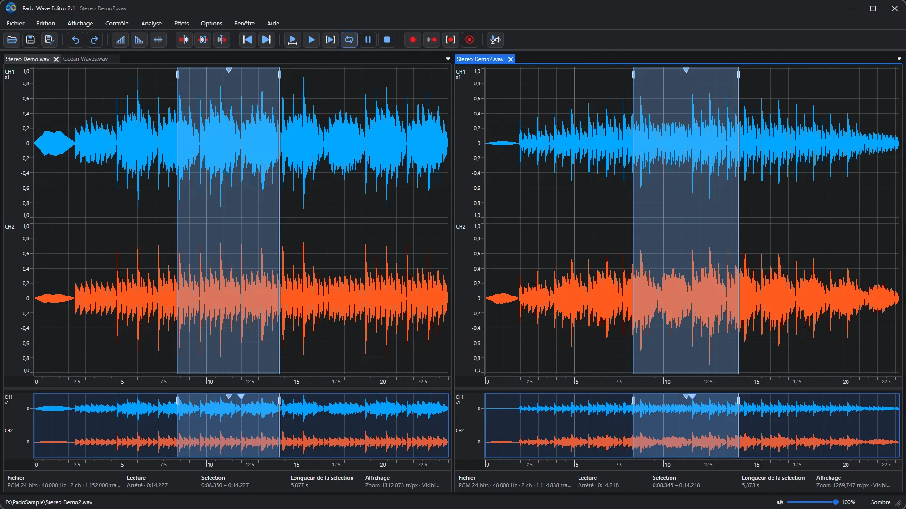
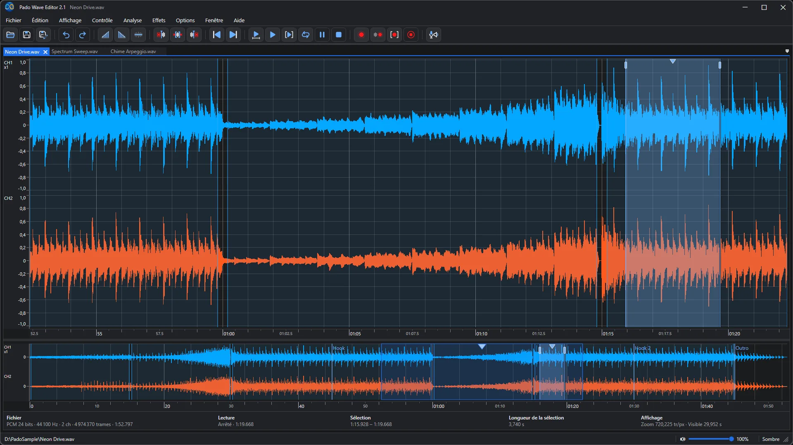
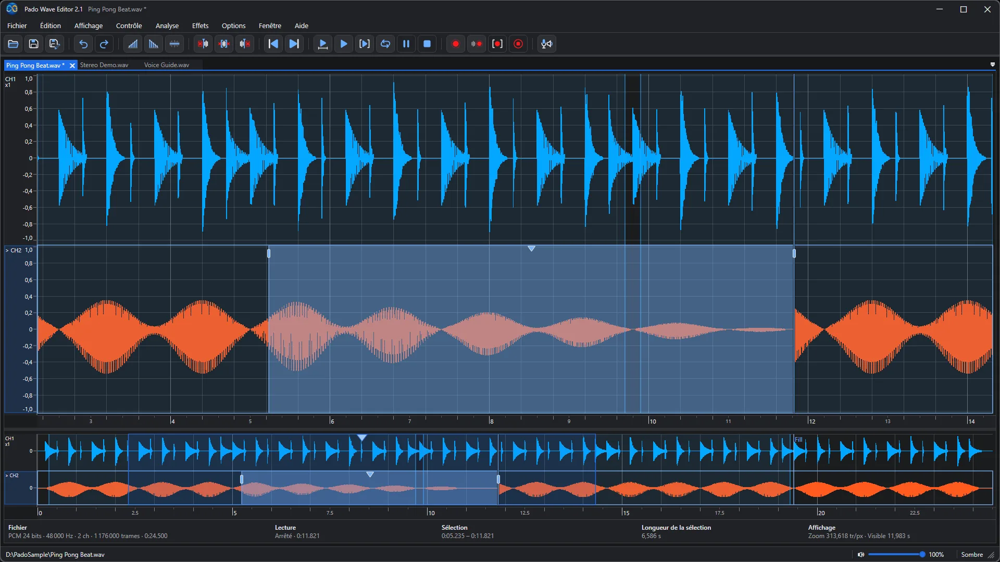
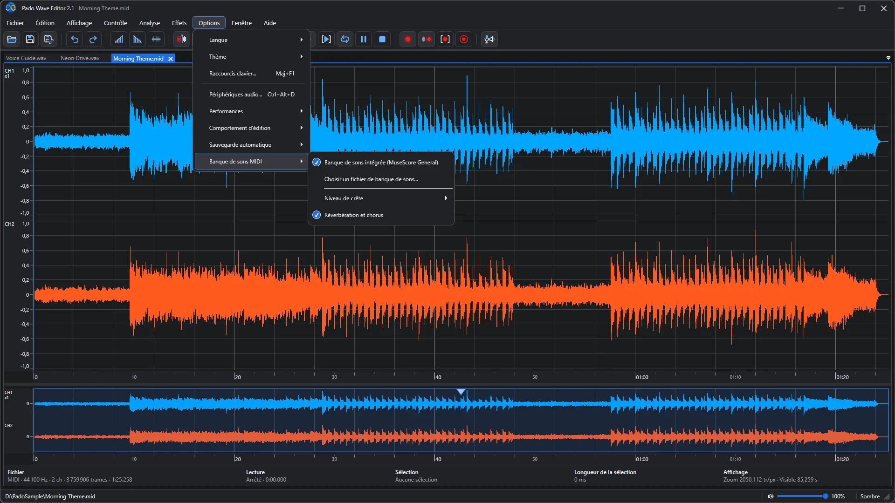
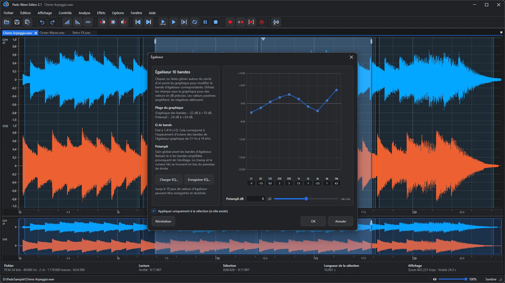
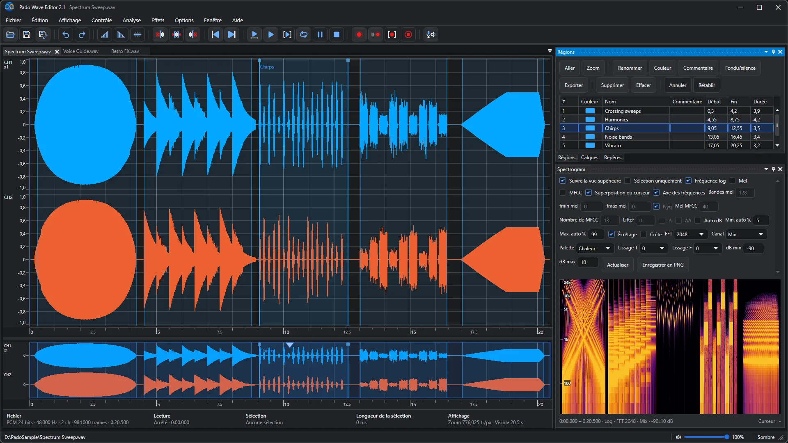
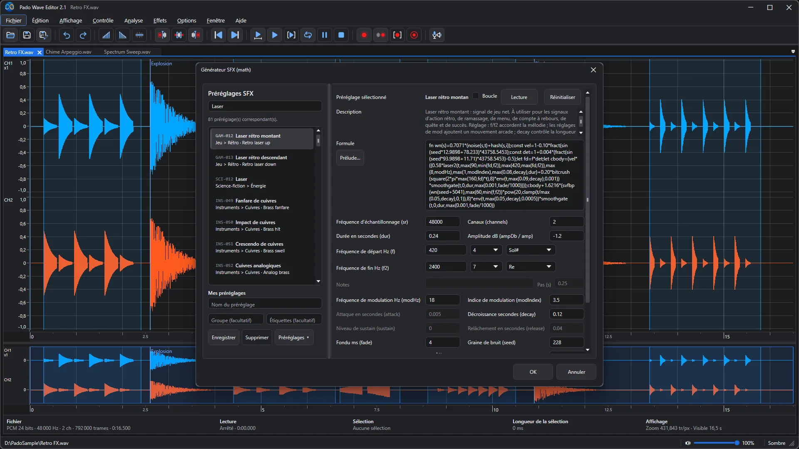
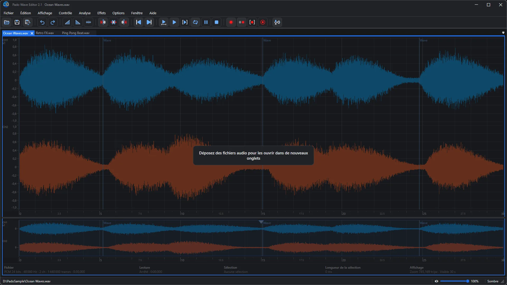
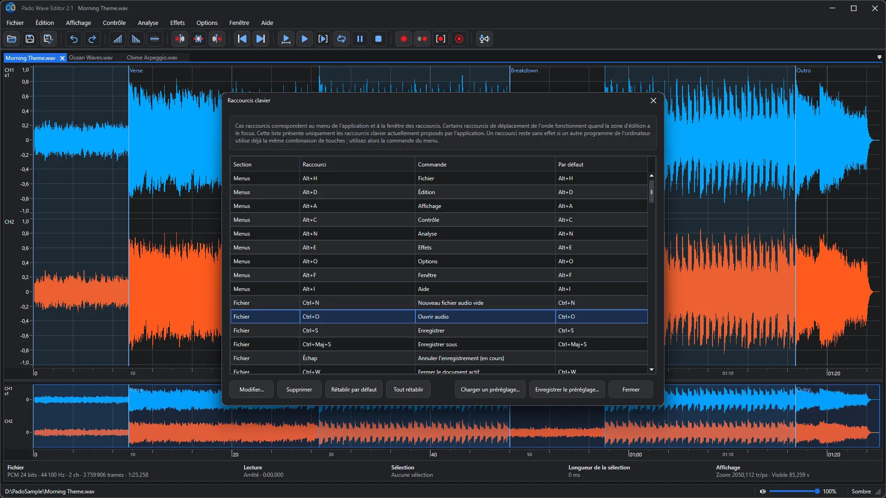
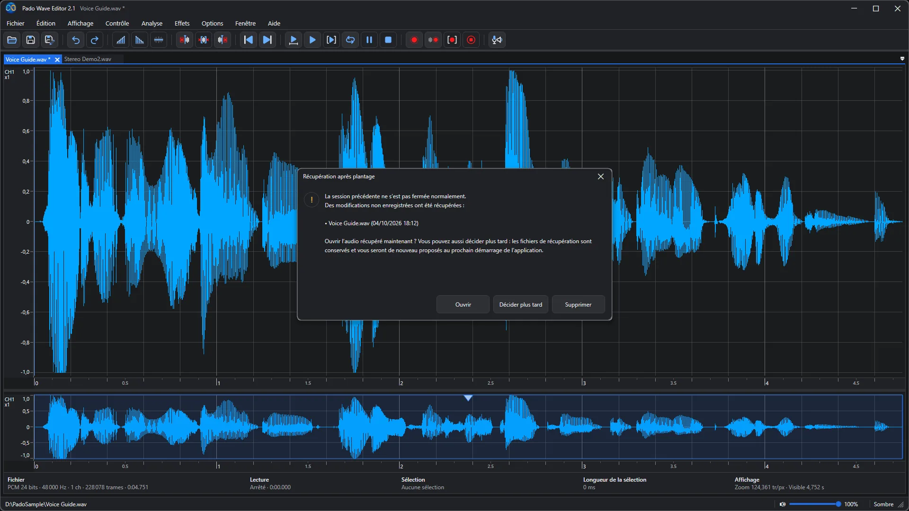

🌐 **Languages**

🇺🇸 [English](README.md) |
🇰🇷 [한국어](README_ko.md) |
🇯🇵 [日本語](README_ja.md) |
🇨🇳 [简体中文](README_zh-Hans.md) |
🇹🇼 [繁體中文](README_zh-Hant.md) |
🇩🇪 [Deutsch](README_de.md) |
🇫🇷 [Français](README_fr.md) |
🇪🇸 [Español](README_es.md) |
🇷🇺 [Русский](README_ru.md) |
🇧🇷 [Português (Brasil)](README_pt-BR.md) |
🇵🇹 [Português (Portugal)](README_pt-PT.md) |
🇸🇦 [العربية](README_ar.md) |
🇮🇳 [हिन्दी](README_hi.md) |
🇮🇩 [Bahasa Indonesia](README_id.md)

    

# Pado Wave Editor 2.1

### Un éditeur audio gratuit pour voir votre son – puis le couper, le coller et le peaufiner

Enregistrements de voix, répétitions de chant, effets sonores pour vos vidéos : déposez un fichier dans la fenêtre et la forme d’onde s’affiche aussitôt. Sélectionnez un passage, coupez, ajoutez un fondu, enregistrez. C’est tout. Le parcours reste simple pour que personne ne se perde, même la première fois.

**Gratuit** · **Windows 10 · 11** · **WAV · MP3 · FLAC · OGG · MIDI** · **14 langues** · **Thèmes clair et sombre**

[Obtenir sur le Microsoft Store](https://apps.microsoft.com/detail/9nj5928hw9pw) · [Guide complet et FAQ](https://easyflow.co.kr/F/Doc/PadoWaveEditor/fr) · [Version précédente (2.0)](v2.0/README_fr.md) · [Version précédente (1.0)](v1.0/README_fr.md)

<i>Ancrez deux fichiers côte à côte et lisez-les ou bouclez-les pendant la comparaison</i>

---

## Parfait pour

- 🎙️ **Nettoyer des enregistrements de voix** — Coupez les erreurs et les longs silences de vos podcasts, présentations et mémos vocaux, et égalisez le volume.
- 🎧 **Comparer deux prises** — Ancrez deux fichiers côte à côte, bouclez le même passage dans chacun et gardez le meilleur.
- 🎹 **Transformer du MIDI en audio** — Ouvrez un morceau MIDI : il est joué directement en forme d’onde. Peaufinez-le et enregistrez-le en WAV ou MP3.
- 🎮 **Sons pour jeux et vidéos** — Choisissez lasers, explosions ou sons de notification parmi les préréglages et créez les vôtres en quelques clics.
- 🎼 **Du jeu à la partition** — Retrouvez les notes d’une performance enregistrée et affichez-les en partition. Cliquez sur une note, corrigez sa position, sa hauteur ou sa durée avec les flèches du clavier (ou supprimez-la avec Suppr), puis enregistrez un fichier MIDI.
- 🔍 **Voir l’intérieur du son** — Repérez à l’œil bruits et clics grâce au spectrogramme et à l’analyse de fréquence.

## Trois étapes, c’est fait

1. **Ouvrir** — Déposez un fichier dans la fenêtre ou appuyez sur Ctrl+O. WAV, MP3, FLAC, OGG et MIDI s’ouvrent tous.
2. **Sélectionner et modifier** — Faites glisser sur la forme d’onde pour sélectionner, puis coupez, ajoutez un fondu ou des effets. Une erreur ? Ctrl+Z.
3. **Enregistrer** — Appuyez sur Ctrl+S ou exportez dans le format voulu.

---

## Visite des fonctionnalités

### 01. Modifiez l’audio dans un espace clair avec des formes d’onde multicanales

Modifiez dans la grande forme d’onde en haut et utilisez la bande d’aperçu en dessous pour savoir où vous êtes dans le fichier. Infos du fichier, position de lecture et longueur de la sélection restent toujours dans la barre d’infos juste sous la forme d’onde. Les longs fichiers affichent d’abord une forme d’onde rapide, puis complètent les détails : pas de longue attente.

### 02. Sélectionnez et modifiez tous les canaux ensemble ou un canal à la fois

En stéréo, sélectionnez les canaux gauche (haut) et droit (bas) ensemble, ou un seul. Supprimez un bruit présent d’un seul côté ou appliquez un fondu à un seul canal : les retouches fines deviennent faciles.

### 03. Ouvrez des fichiers MIDI en forme d’onde, joués par la banque de sons intégrée

Un fichier MIDI (.mid, .midi, .rmi) contient des notes, pas du son. Pado Wave Editor le joue avec la banque de sons intégrée (MuseScore General) et affiche le résultat en forme d’onde : coupez, ajoutez des effets et enregistrez en WAV ou MP3 comme n’importe quel audio. Vous préférez une autre banque SF2 ou SF3 ? Changez-la dans Options.

### 04. Ajustez et analysez le son avec des effets, filtres et outils d’analyse

Appliquez égaliseur, filtres, compresseur, normalisation et plus encore à la seule sélection. Faites glisser les points du graphique pour façonner le son et enregistrez jusqu’à 10 réglages d’égaliseur pour les recharger plus tard.

### 05. Naviguez à l’aide des régions, repères, calques et du spectrogramme

Régions nommées et colorées, repères de position et calques qui activent ou désactivent un traitement pour comparer : vous gardez le cap même dans de longs fichiers. Le spectrogramme affiche le son en couleurs selon la fréquence, pour repérer bruits et clics à l’œil.

### 06. Créez des effets sonores à partir de centaines de préréglages basés sur des formules

Parcourez des centaines de préréglages – lasers, explosions, alertes, même des instruments – ajustez fréquence, durée et décroissance et écoutez tout de suite. Enregistrez vos favoris comme préréglages perso. Idéal pour créer vos propres sons pour jeux et vidéos.

### 07. Glissez-déposez des fichiers audio pour les ouvrir dans de nouveaux onglets

Faites simplement glisser des fichiers audio depuis l’Explorateur vers la fenêtre : chacun s’ouvre dans un nouvel onglet. Vous pouvez en déposer plusieurs à la fois.

### 08. Consultez et personnalisez les raccourcis clavier

Consultez menus et raccourcis dans un seul tableau, changez n’importe quelle touche ou rétablissez la valeur par défaut. Enregistrez votre configuration comme préréglage et rechargez-la quand vous voulez.

### 09. Récupérez automatiquement le travail non enregistré après une fermeture inattendue

Si l’application se ferme de façon inattendue, pas de panique. Au prochain démarrage, elle retrouve votre travail non enregistré et vous demande de l’ouvrir, de décider plus tard ou de l’abandonner. Choisissez « plus tard » : les fichiers de récupération sont conservés et reproposés au démarrage suivant.

---

## Nouveautés de la 2.1

- Boîtes de dialogue Ouvrir et Enregistrer : nouvelle zone Rechercher, option Fichiers en premier et noms de fichiers triés dans l’ordre numérique.
- Choisissez comment l’affichage suit la lecture : tête de lecture au centre ou page suivante au bord droit.
- Une nouvelle lecture lancée après la fin du fichier repart du début.
- Le compresseur peut compresser plus en douceur et ne plus laisser passer les sons forts soudains.
- Les effets appliqués à de longues sélections affichent leur progression et peuvent être annulés.
- Affichage de la forme d’onde, fenêtre Partition et copier-coller plus rapides.
- Les nombres et les dates suivent le format régional de Windows, et les messages d’erreur et d’état s’affichent dans les 14 langues.
- Corrections pour l’égaliseur, l’aperçu du Générateur SFX, la mise en page en arabe et plus encore, ainsi que des icônes plus nettes.

La version 2.0 a apporté les fichiers MIDI en forme d’onde, le glisser-déposer, Ogg Vorbis et FLAC sur toutes les éditions de Windows, des raccourcis clavier personnalisables, la récupération automatique des fichiers, des fichiers et enregistrements longs plus rapides, ainsi qu’une apparence rafraîchie. [Version précédente (2.0)](v2.0/README_fr.md)

## Toutes les fonctionnalités en un coup d’œil

- Ouvrez les fichiers audio pris en charge et modifiez tous les canaux ou un seul canal.
- Ouvrez des fichiers MIDI (.mid, .midi, .rmi) en formes d’onde modifiables, jouées par la banque de sons intégrée.
- Analysez les notes d’un enregistrement, affichez-les en partition, corrigez-les et enregistrez-les en fichier MIDI.
- Coupez, copiez, collez, supprimez, mettez en sourdine, appliquez des fondus, annulez et rétablissez.
- Lisez, bouclez, enregistrez, sauvegardez et exportez dans un seul espace de travail.
- Utilisez régions, repères, calques et spectrogrammes pour naviguer et analyser visuellement.
- Appliquez suppression du décalage DC, filtres, égalisation, bass shelf, compression, volume, normalisation et hard clip.
- Modifiez la vitesse, rééchantillonnez et créez des sons avec le générateur SFX.
- Réduisez les clics grâce au fondu enchaîné automatique, à l’alignement et aux fondus courts.
- Gardez les longs fichiers réactifs grâce au mode PC modeste et au raffinement progressif de la forme d’onde.

L’interface et l’aide intégrée sont localisées. Certains noms standard d’effets, de formats de fichier et termes techniques restent en anglais.

## Configuration requise

Formats pris en charge : WAV, AIFF, FLAC, Ogg Vorbis, MP3, WMA. MP3 et WMA utilisent les composants multimédias Windows inclus dans la plupart des éditions de Windows ; sur les éditions Windows N, installez le Media Feature Pack gratuit (Paramètres > Applications > Fonctionnalités facultatives) pour les activer. WAV, AIFF, FLAC et Ogg Vorbis fonctionnent toujours. La visionneuse d’aide intégrée utilise Microsoft Edge WebView2 Runtime, fourni avec Windows 11 et déjà installé sur la plupart des PC Windows 10 ; s’il est absent, seule la visionneuse d’aide est affectée et l’édition audio continue de fonctionner.

---

## Téléchargement

- [Obtenir sur le Microsoft Store](https://apps.microsoft.com/detail/9nj5928hw9pw)
- Le programme d’installation des **Releases** ouvre lui aussi le Microsoft Store et installe la version officielle.
- [Guide complet et FAQ](https://easyflow.co.kr/F/Doc/PadoWaveEditor/fr)
- [Version précédente (2.0)](v2.0/README_fr.md)
- [Version précédente (1.0)](v1.0/README_fr.md)

© 2026 Easyflow Inc.
