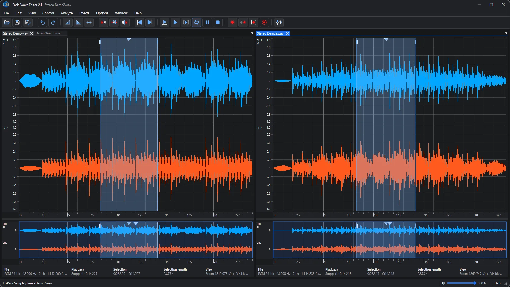
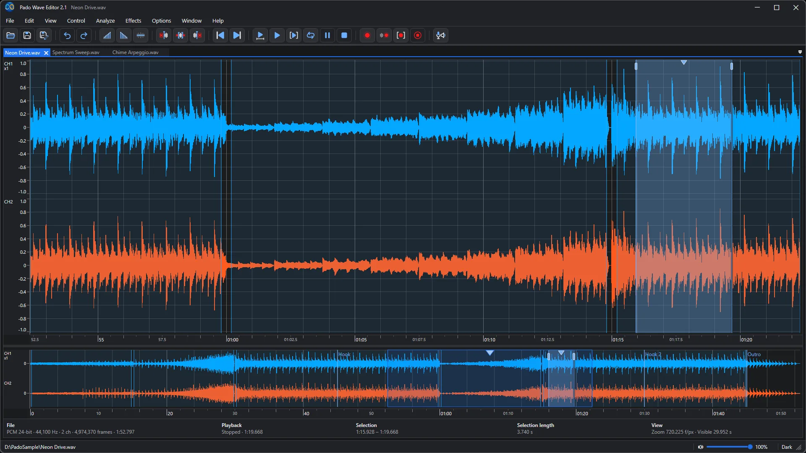
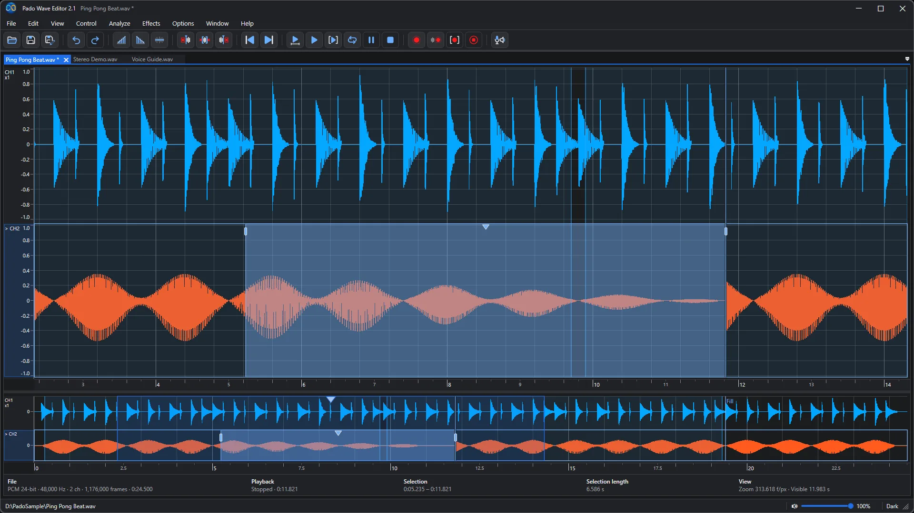
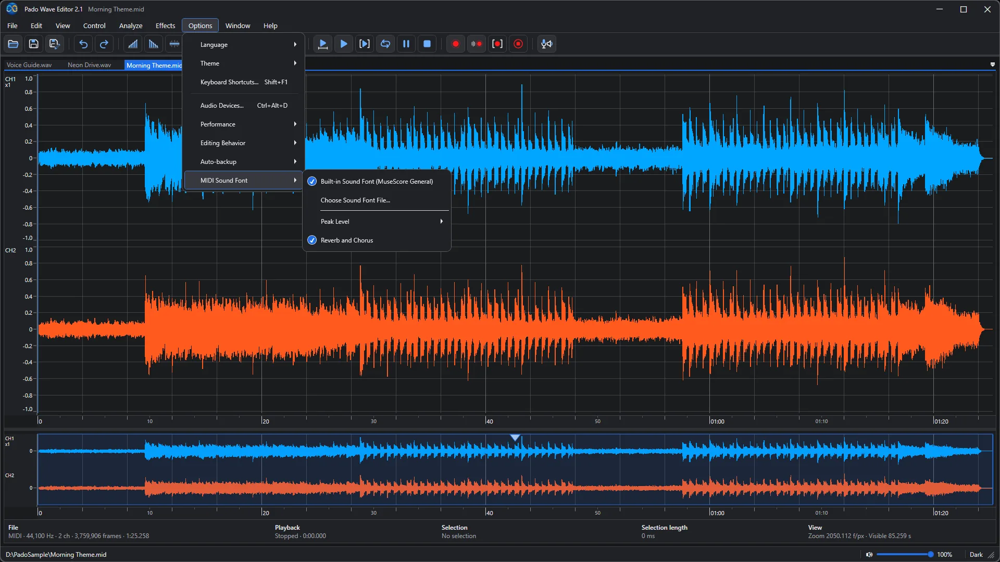
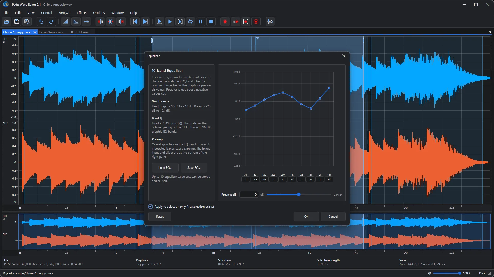
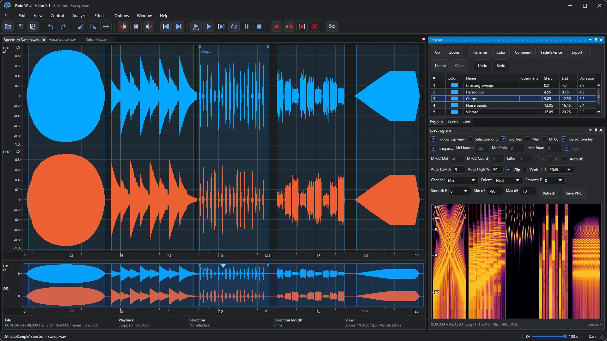
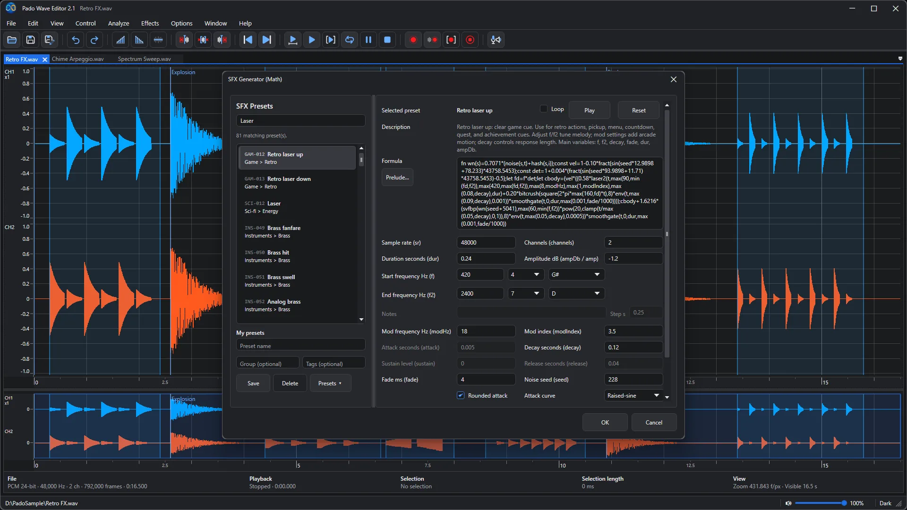
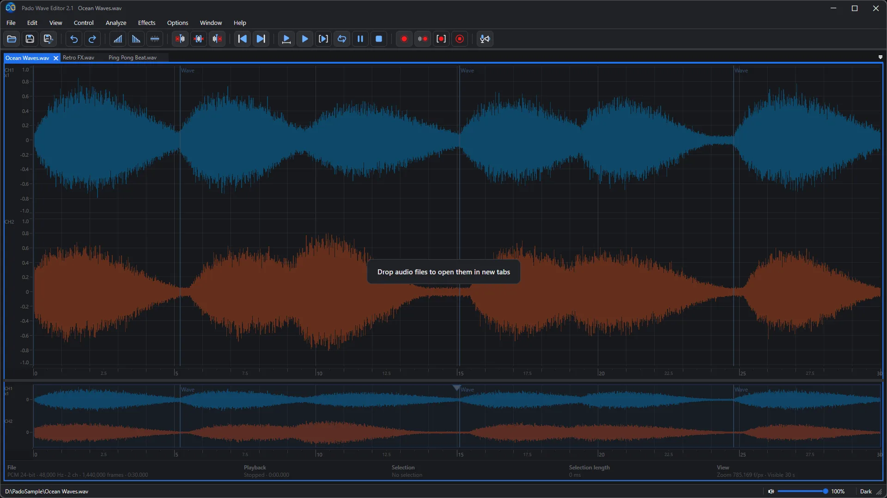
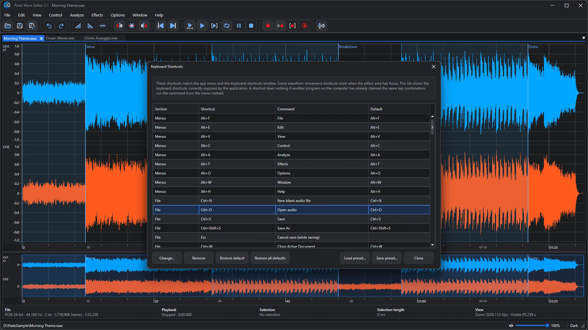
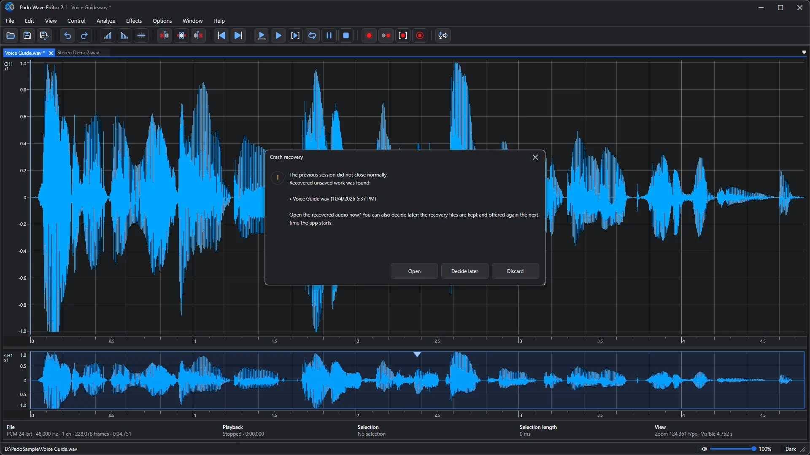

🌐 **Languages**

🇺🇸 [English](README.md) |
🇰🇷 [한국어](README_ko.md) |
🇯🇵 [日本語](README_ja.md) |
🇨🇳 [简体中文](README_zh-Hans.md) |
🇹🇼 [繁體中文](README_zh-Hant.md) |
🇩🇪 [Deutsch](README_de.md) |
🇫🇷 [Français](README_fr.md) |
🇪🇸 [Español](README_es.md) |
🇷🇺 [Русский](README_ru.md) |
🇧🇷 [Português (Brasil)](README_pt-BR.md) |
🇵🇹 [Português (Portugal)](README_pt-PT.md) |
🇸🇦 [العربية](README_ar.md) |
🇮🇳 [हिन्दी](README_hi.md) |
🇮🇩 [Bahasa Indonesia](README_id.md)

    

# Pado Wave Editor 2.1

### 一边看着声音，一边剪切、粘贴、打磨——免费的音频编辑器

人声录音、唱歌练习、给视频配的音效，全都可以。把文件拖进窗口，波形立刻出现；拖动选中想要的片段，剪掉、加个淡入淡出、保存，就完成了。流程保持简单，第一次用也不会迷路。

**免费** · **Windows 10 · 11** · **WAV · MP3 · FLAC · OGG · MIDI** · **14 种语言** · **浅色/深色主题**

[从 Microsoft Store 获取](https://apps.microsoft.com/detail/9nj5928hw9pw) · [详细说明与常见问题](https://easyflow.co.kr/F/Doc/PadoWaveEditor/zh-Hans) · [上一版本（2.0）介绍](v2.0/README_zh-Hans.md) · [上一版本（1.0）介绍](v1.0/README_zh-Hans.md)

<i>将两个文件左右并排停靠，边比较边播放或循环播放</i>

---

## 这些时候最合适

- 🎙️ **整理人声录音** — 从播客、演讲和语音备忘录中剪掉口误和长时间停顿，并让音量更均匀。
- 🎧 **对比两个版本** — 把两个文件左右并排，轮流循环同一段，留下更好的那一个。
- 🎹 **把 MIDI 变成音频** — 打开 MIDI 乐曲，立即演奏并显示为波形。修整后保存为 WAV 或 MP3。
- 🎮 **游戏和视频音效** — 从预设中挑选激光、爆炸、提示音等音效，点几下就能做出自己的声音。
- 🎼 **把演奏变成乐谱** — 从录下的演奏中找出音符并以乐谱显示。点击音符，用方向键修改位置、音高或时值（或按 Delete 删除），然后保存为 MIDI 文件。
- 🔍 **看清声音的内部** — 用频谱图和频率分析，直接用眼睛找到噪音和爆音的位置。

## 三步搞定

1. **打开** — 把文件拖进窗口或按 Ctrl+O。WAV、MP3、FLAC、OGG、MIDI 都能打开。
2. **选中并编辑** — 在波形上拖动选择片段，然后剪切、淡入淡出或添加效果。出错了？按 Ctrl+Z。
3. **保存** — 按 Ctrl+S 保存，或导出为需要的格式。

---

## 功能导览

### 01. 在清晰的多声道波形工作区中编辑音频

在上方的大波形中编辑，下方的概览条让你一眼看出当前位于整个文件的哪里。文件信息、播放位置和选区长度始终显示在波形正下方的信息栏。长文件也会先快速显示波形，再补全细节，不用久等。

### 02. 同时编辑全部声道，或逐个选择声道进行精细编辑

立体声音频可以同时选择左（上）右（下）两个声道，也可以只选其中一个。只清除一侧的噪音，或只给一个声道加淡入淡出，精细修改很轻松。

### 03. 用内置音色库演奏 MIDI 文件，并以波形打开和编辑

MIDI 文件（.mid、.midi、.rmi）里装的是音符，不是声音。打开后，应用用内置音色库（MuseScore General）演奏并显示为波形，你可以像普通音频一样剪切、加效果，并保存为 WAV 或 MP3。更喜欢别的 SF2 或 SF3 音色库？在“选项”中切换即可。

### 04. 使用效果、滤波器和分析工具调整并检查声音

均衡器、滤波器、压缩器、标准化等效果可以只应用到选中的片段。拖动图上的点来塑造声音，均衡器设置最多可保存 10 组，之后再载入。

### 05. 通过区域、提示点、图层和频谱图面板快速定位

可命名、可着色的区域，标记位置的提示点，可开关处理结果进行对比的图层，让你在长文件中也不会迷路。频谱图用颜色按频率显示声音，噪音和爆音一眼就能找到。

### 06. 使用数百个基于公式的预设生成音效

搜索数百个预设——激光、爆炸、提示音，甚至乐器声——调整频率、时长、衰减等参数并立即试听。喜欢的设置可以保存为“我的预设”。非常适合为游戏和视频自制音效。

### 07. 将音频文件拖放到编辑器中，在新标签页中打开

只要把音频文件从文件资源管理器拖到窗口上，每个文件都会在新标签页中打开。也可以一次拖入多个文件。

### 08. 查看并自定义键盘快捷键

在一张表中查看菜单和快捷键，可改成任意按键，也可恢复默认值。把自己的设置保存为预设，随时都能再载入。

### 09. 意外关闭后自动恢复未保存的工作

工作时应用意外关闭也别慌。下次启动时，它会找到未保存的工作，询问你要打开、稍后决定还是丢弃。选择“稍后”，恢复文件会保留，下次启动时再次提示。

---

## 2.1 新功能

- 打开和保存对话框：新增搜索框，可将文件显示在文件夹上方，文件名按数字顺序排序。
- 可选择播放时视图跟随播放位置的方式：播放头居中，或到右边缘时翻到下一屏。
- 播放到文件末尾后再次播放，将从头开始。
- 压缩器可设置为压缩更自然，并且不会漏掉突然变大的声音。
- 对较长范围应用效果时会显示进度，并可中途取消。
- 波形显示、乐谱窗口以及复制和粘贴速度更快。
- 数字和日期遵循 Windows 区域设置，错误和状态消息以 14 种语言显示。
- 修复了均衡器、SFX 生成器预览、阿拉伯语界面布局等问题，应用图标也更加清晰。

版本 2.0 新增了以波形打开 MIDI 文件、拖放打开、在所有 Windows 版本上支持 Ogg Vorbis 和 FLAC、自定义键盘快捷键、自动恢复文件、更快处理长文件和长时间录音，以及全新外观。 [上一版本（2.0）介绍](v2.0/README_zh-Hans.md)

## 全部功能一览

- 打开支持的音频文件，并可同时编辑全部声道或单独编辑一个声道
- 用内置音色库演奏 MIDI 文件（.mid、.midi、.rmi），并以可编辑的波形打开
- 分析录音中的音符，以乐谱显示并修改，然后保存为 MIDI 文件
- 对所选音频执行剪切、复制、粘贴、删除、静音、淡化、撤销和重做
- 在同一工作区中完成播放、循环播放、录音、保存和导出
- 使用区域、提示点、图层和频谱图面板进行导航与视觉分析
- 提供DC偏移移除、滤波、均衡、低频搁架、压缩、音量、标准化和硬限幅
- 更改播放速度、重采样并使用SFX生成器创建声音
- 通过自动交叉淡化、吸附和短淡化减少编辑点的点击声
- 通过低配置电脑优化和分阶段波形细化保持长文件操作流畅

界面和应用内帮助已本地化。部分标准音频效果名称、文件格式名称和技术术语仍以英文显示。

## 系统要求

支持的格式：WAV、AIFF、FLAC、Ogg Vorbis、MP3、WMA。MP3 和 WMA 使用大多数 Windows 版本自带的 Windows 媒体组件；在 Windows N 版本中，请在“设置 > 应用 > 可选功能”中安装免费的 Media Feature Pack 后即可使用。WAV、AIFF、FLAC 和 Ogg Vorbis 始终可用。应用内帮助查看器使用 Microsoft Edge WebView2 Runtime，它随 Windows 11 提供，并且已预装在大多数 Windows 10 电脑上；若缺少该运行时，仅帮助查看器受影响，音频编辑不受影响。

---

## 下载

- [从 Microsoft Store 获取](https://apps.microsoft.com/detail/9nj5928hw9pw)
- 运行 **Releases** 中的安装程序也会打开 Microsoft Store 并安装官方版本。
- [详细说明与常见问题](https://easyflow.co.kr/F/Doc/PadoWaveEditor/zh-Hans)
- [上一版本（2.0）介绍](v2.0/README_zh-Hans.md)
- [上一版本（1.0）介绍](v1.0/README_zh-Hans.md)

© 2026 Easyflow Inc.
